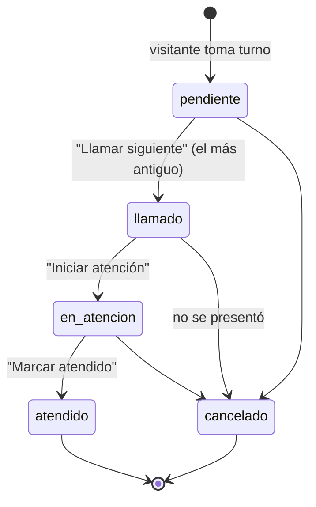

# Estados y reglas de numeración · FilaCero

## 1. Reglas de numeración de folios

### 1.1 Formato del folio

Cada turno recibe un folio con el formato `PREFIJO-NNN`:

- `PREFIJO` es el prefijo del servicio (2 a 4 letras, único en la tabla `servicios`).
- `NNN` es el consecutivo con tres dígitos y ceros a la izquierda.

Se arma en `emitir_turno()` (`src/turnos.php`) con:

```php
$folio = sprintf('%s-%03d', $servicio['prefijo'], $consecutivo); // ASE-001
```

### 1.2 Serie = servicio + día

- Cada servicio lleva **su propia serie**: Asesoría y Constancias cuentan por separado.
- Cada día la serie **vuelve a empezar en 001**.

| Momento | Servicio | Folio |
|---|---|---|
| Lunes, 1.er turno | Asesoría (`ASE`) | `ASE-001` |
| Lunes, 2.º turno | Asesoría (`ASE`) | `ASE-002` |
| Lunes, 1.er turno | Constancias (`CON`) | `CON-001` |
| Martes, 1.er turno | Asesoría (`ASE`) | `ASE-001` |

### 1.3 Cálculo del consecutivo

El siguiente número se calcula con el mayor consecutivo de la serie más uno.
Si la serie todavía no tiene turnos, `COALESCE` regresa 0 y el primero es 1.

```sql
SELECT COALESCE(MAX(consecutivo), 0) + 1
  FROM turnos
 WHERE servicio_id = :servicio_id AND fecha = :fecha
```

La fecha se genera en PHP con `today()` usando la zona horaria `America/Mexico_City`.
El turno se guarda en estado `pendiente` junto con `fecha`, `consecutivo`, `folio` y `creado_en`.

### 1.4 Defensas contra folios duplicados

| Defensa | Dónde | Estado |
|---|---|---|
| `UNIQUE(servicio_id, fecha, consecutivo)` y `UNIQUE(fecha, folio)`: la base rechaza cualquier duplicado | `database/schema.sql` | Implementada (HU-01) |
| Lectura del `MAX` e `INSERT` dentro de una transacción `BEGIN IMMEDIATE`, para que dos personas que piden turno al mismo tiempo no lean el mismo número | `src/db.php` · `src/turnos.php` | Pendiente (HU-07) |

### 1.5 Servicios que no emiten turnos

| Caso | Resultado | Estado |
|---|---|---|
| Servicio inexistente | Mensaje "El servicio no existe." en el kiosco | Implementada (HU-03) |
| Servicio inactivo | Mensaje "Ese servicio no está disponible en este momento" | Pendiente (HU-07) |

## 2. Diagrama de estados de un turno

Un turno pasa por distintos estados desde que el visitante lo solicita en el kiosco hasta que concluye su atención o es cancelado:



### 2.1 Reglas de transición

- "Llamar siguiente" solo toma turnos en estado `pendiente` (el más antiguo registrado), nunca un turno `cancelado` o `atendido`. 
- Si la cola está vacía, el sistema muestra un aviso informativo sin generar error.
- Un operador no puede llamar otro turno si ya tiene uno en estado `llamado` o `en_atencion`.
- Un operador no puede modificar el turno asignado a otro operador (el administrador solo puede cancelarlo).
- Si el turno no existe, el sistema responde "El turno no existe".
- `atendido` y `cancelado` son estados finales; no admiten cambios posteriores.
- Cada cambio de estado queda registrado en la bitácora (`atenciones`) indicando quién lo realizó, cuándo y la transición efectuada.
