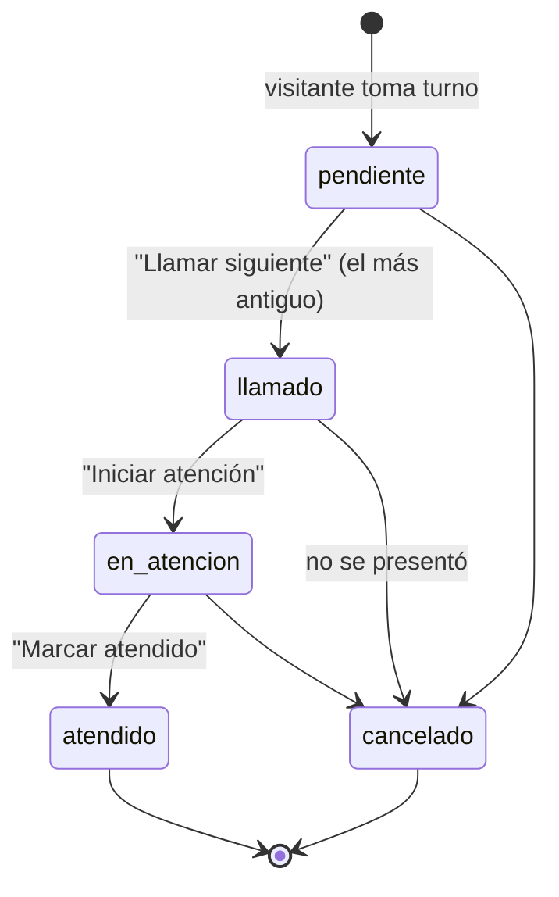

## Diagrama de estados de un turno

Un turno pasa por distintos estados desde que el visitante lo solicita en el kiosco hasta que concluye su atención o es cancelado:

### Reglas de transición

- "Llamar siguiente" solo toma turnos en estado `pendiente` (el más antiguo registrado), nunca un turno `cancelado` o `atendido`. 
- Si la cola está vacía, el sistema muestra un aviso informativo sin generar error.
- Un operador no puede llamar otro turno si ya tiene uno en estado `llamado` o `en_atencion`.
- Un operador no puede modificar el turno asignado a otro operador (el administrador solo puede cancelarlo).
- Si el turno no existe, el sistema responde "El turno no existe".
- `atendido` y `cancelado` son estados finales; no admiten cambios posteriores.
- Cada cambio de estado queda registrado en la bitácora (`atenciones`) indicando quién lo realizó, cuándo y la transición efectuada.