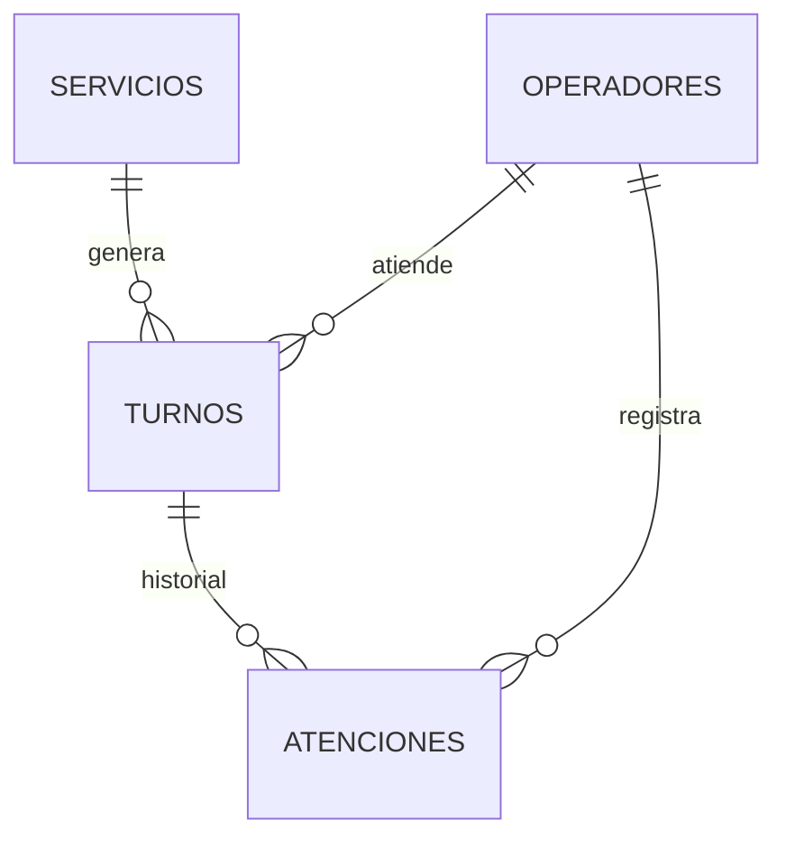

# Modelo de datos y contratos de funciones · FilaCero

## Tablas en SQLite (`database/schema.sql`)

| Tabla | Campos principales | Reglas e integridad |
|---|---|---|
| `servicios` | `id`, `prefijo` (2 a 4 letras, único), `nombre`, `descripcion`, `activo`, `created_at`, `updated_at` | `UNIQUE(prefijo)` y `CHECK(length(prefijo) BETWEEN 2 AND 4)` |
| `operadores` | `id`, `nombre`, `usuario` (único), `password_hash`, `rol` (`operador`/`admin`), `ventanilla`, `activo`, `created_at` | `UNIQUE(usuario)` y `CHECK(rol IN ('operador', 'admin'))` |
| `turnos` | `id`, `servicio_id`, `fecha`, `consecutivo`, `folio`, `estado`, `operador_id`, `ventanilla`, `motivo_cancelacion`, `creado_en`, `llamado_en`, `atencion_en`, `cerrado_en` | `UNIQUE(servicio_id, fecha, consecutivo)`, `UNIQUE(fecha, folio)`, `CHECK` de estados válidos y llaves foráneas |
| `atenciones` | `id`, `turno_id`, `operador_id`, `estado_anterior`, `estado_nuevo`, `nota`, `creado_en` | Bitácora de auditoría para cada transición de estado |

## Diagrama Entidad-Relación

## Contratos de funciones compartidas (`src/`)

Todas las consultas devuelven arreglos asociativos (`PDO::FETCH_ASSOC`) con los nombres exactos de las columnas de `database/schema.sql`:

- `operador_actual(): ?array` devuelve `['id', 'nombre', 'usuario', 'rol', 'ventanilla']` o `null` si no hay sesión activa.
- `emitir_turno(int $servicioId, ?string $momento = null): array` devuelve el registro completo del turno recién creado (`id`, `folio`, `estado`, `creado_en`, etc.).
- `cola_pendiente(?int $servicioId = null): array` devuelve la lista de turnos `pendiente` del día ordenados por `id ASC`, incluyendo `servicio_nombre` y `servicio_prefijo` mediante `JOIN`.
- `turnos_en_ventanilla(): array` devuelve los turnos en estado `llamado` o `en_atencion` de hoy, ordenados por `llamado_en DESC`.
- `espera_por_servicio(): array` devuelve los servicios activos con la llave extra `'pendientes' => int` (`0` si no hay turnos en espera).
